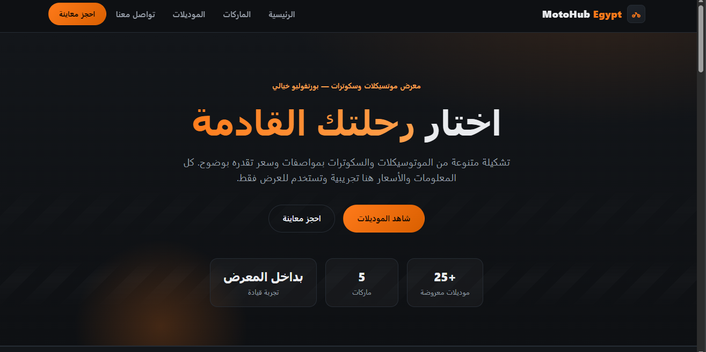
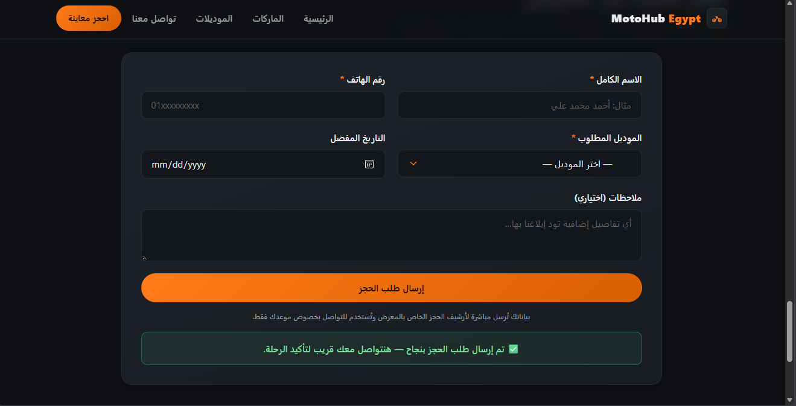

# MotoHub Egypt

موقع معرض موتسيكلات وسكوترات خيالي — مشروع بورتفوليو واجهة أمامية يعرض تشكيلة ماركات وموديلات مع نموذج حجز معاينة.

## ✨ Live Demo

👉 **[شاهد الموقع مباشرة](https://ahmeddsamii21.github.io/motohub-egypt/)** — https://ahmeddsamii21.github.io/motohub-egypt/

> ⚠️ **تنويه:** هذا المشروع تجريبي مبني لأغراض العرض والتعلّم فقط. لا يمثل وكيلًا رسميًا لأي علامة تجارية. جميع الماركات والموديلات والأسعار والبيانات في الموقع توضيحية (illustrative) ولأغراض العرض فقط — لا يوجد عملاء حقيقيون ولا تجارة فعلية.

## المميزات

- 🎨 **تصميم RTL متجاوب** — عربي بالكامل، ثيم داكن أنيق مستوحى من عالم الموتوسيكلات، ومتوافق مع الموبايل والكمبيوتر.
- 🏍️ **عرض ماركات وموديلات** — قسم ماركات بالأسماء فقط، وقسم موديلات مميزة ببطاقات تتضمن الفئة والسعة والسعر بصيغة "يبدأ من".
- 📅 **نموذج حجز معاينة** — حقول للاسم والهاتف والموديل والتاريخ المفضل مع تحقق عربي من البيانات ورسائل نجاح/خطأ واضحة.
- 🔗 **ربط الطلبات تلقائيًا بـGoogle Sheets** — عند إرسال النموذج تُرسل بيانات الحجز مباشرة إلى ورقة Google عبر Google Apps Script (التكامل موجود في الكود داخل `src/components/BookingForm.jsx`).

## التقنيات

- [React](https://react.dev/) — واجهة المستخدم ومكوّنات منظمة
- [Vite](https://vite.dev/) — أدوات التطوير والبناء
- CSS خالص — بدون مكتبات واجهة إضافية
- [Google Apps Script](https://script.google.com/) — استقبال طلبات الحجز
- [Google Sheets](https://sheets.google.com/) — تخزين طلبات الحجز

## التشغيل محليًا

```bash
# 1. تثبيت الحزم
npm install

# 2. تشغيل خادم التطوير
npm run dev
```

ثم افتح الرابط الظاهر في الطرفية (افتراضيًا `http://localhost:5173/`).

لبناء نسخة الإنتاج:

```bash
npm run build
npm run preview
```

لفحص جودة الكود بسرعة (اختياري):

```bash
npm run lint
```

## 🚀 النشر

الموقع منشور على **GitHub Pages** عبر GitHub Actions (ملف `.github/workflows/deploy.yml`).
أي رفع جديد إلى فرع `main` يبني الموقع وينشره تلقائيًا على:

- https://ahmeddsamii21.github.io/motohub-egypt/

## ⚠️ المنهجية والقيود المعروفة

**ما تم التحقق منه فعليًا:**
- وحدة الواجهة كاملة تعمل على GitHub Pages (الرابط المباشر أعلاه).
- نموذج الحجز متصل بورقة Google عبر Google Apps Script — تم اختبار إرسال يدوي حقيقي وظهرت البيانات في الورقة.
- التحقق العربي من الحقول يعمل (فحص فعلي بالمتصفح).

**قيود معروفة (للشفافية):**
- **بيانات توضيحية فقط:** جميع الماركات والموديلات والأسعار وهمية لأغراض العرض.
- **صفحة واحدة:** SPA بدون توجيه أو صفحات فرعية أو خادم خلفي خاص.
- **وضع "no-cors":** رسالة "نجاح الإرسال" في المتصفح تعني فقط "لم يحدث خطأ شبكة". تأكيد الكتابة الفعلية في الورقة تم يدويًا مرة واحدة (بواسطتك) — لا يوجد تحقق تلقائي في الكود الحالي.
- **لا اختبارات آلية:** لا توجد suite اختبارات وحدة/Integration في المشروع حاليًا؛ الجودة مشروطة بعد إجراء `npm run lint` + `npm run build` يدويًا.

## Screenshots

1. الصفحة الرئيسية وأقسام العرض:

   

2. نموذج حجز المعاينة:

   

---

Made as a fictional portfolio project — not affiliated with any brand.
